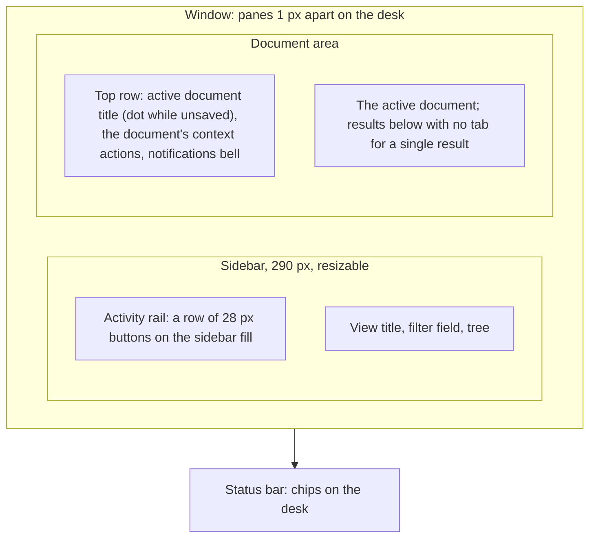

# DBFlux Desktop: the fork's look

This checkout is a fork whose look follows **Visual Studio Code's default dark
theme**, not upstream DBFlux. When a design question comes up, ask "what does
VS Code do here?" and do that, within the components and tokens of the `bolt`
crate. This look is fork-only: keep it out of upstream pull requests.

## Principles

1. **VS Code is the reference.** Layout, density, selection, focus, pickers and
   wording follow VS Code. When a screen has no VS Code counterpart, make it
   look like it belongs next to VS Code's own panels.
2. **Calm, flat, neutral.** Panes are one flat gray. Regions are separated by a
   1 px line or a 1 px gap, never by shadow, gradient or a darker band. The only
   shadows are on floating things: menus, popovers, the command palette.
3. **The accent is rare.** Blue marks the focused input, the selected row of a
   picker, a primary button, a link, the caret. It is not used for section
   labels, selected tree rows, active rail buttons or decorative icons.
4. **Less chrome, more content.** Hide what VS Code hides: the document tab
   strip is off, a single result shows no result tab, footers and headers that
   only repeat information are removed. Give vertical space back to the
   document.
5. **Real logos, plain glyphs.** Database and file brands use their own
   full-color logos. Interface glyphs are monochrome Material Symbols.
6. **Change only what was asked.** Do not swap in a named theme (Tokyo Night,
   One Dark, ...), shift the palette, or restyle neighbouring screens unless
   asked. A color change names the exact role and value it changes.

## Colors

### Dark (the shipped palette)

| Role | Value | Theme field / accessor | Use |
|---|---|---|---|
| desk | `#121314` | `ChromeColors::desk` | the 1 px gaps between panes, status bar ground, window frames of Settings and Connection Manager |
| background / panel | `#191A1B` | `background`, `popover`, `table` | every pane, the sidebar, the editor, cards, menus, modals |
| raised | `#232425` | `secondary` | secondary buttons, keycaps, chips |
| line | `#2B2C2E` | `border` | separators inside a pane, input edges |
| line-2 | `#3C3D40` | `input`, `muted` | control edges on raised surfaces, card and modal edges |
| row divider | `#1F2021` | `table_row_border` | grid row dividers |
| strong | `#E4E4E6` | `ChromeColors::strong` | titles, values, text on a selected picker row |
| body | `#CCCCCF` | `foreground` | body copy, labels of buttons |
| muted | `#9A9B9F` | `muted_foreground` | metadata, folders after a file name, section labels, inactive items |
| accent | `#7AA2F7` | `primary`, `ring`, `ChromeColors::tint` | focus border, caret, picker selection, primary button, links |
| success / info / warning / danger | `#7BE0A0` / `#6EA8FF` / `#FFC23D` / `#FF6B5E` | `success`, `info`, `warning`, `danger` | state only: connected, links and foreign keys, caution and primary keys, errors and production |

The user can override the accent in Settings; every rule above still holds
with their accent.

### Washes

| Wash | Dark | Where |
|---|---|---|
| hover | white 4 % | hovered rows, menu rows, ghost buttons |
| alternating row | white 3.5 % | every other grid row, visible across a wide grid |
| selected item | white 8 % (black 7 % on Light) | selected tree, sidebar and list row: a neutral lift, no accent bar, the row icon keeps its own color |
| selected grid row | accent wash (`table_active`) | the row holding the focused cell |
| picker selection | accent at 55 % (`PaletteMetrics::SELECTED_FILL_ALPHA`) | the selected row of the command palette, with strong text |
| scrim | `#121314` 62 % | behind modal dialogs only; quick pickers have none |

### Light

The Light palette (`Palette::light()` in `crates/bolt/src/theme.rs`) is still
upstream's lavender grays with the byzantine accent; it has not been reworked
toward VS Code Light yet. Keep it working, and do not restyle it unless asked.

## Typography

| Family | Resolved from | Use |
|---|---|---|
| interface | the first installed of Ubuntu, Noto Sans, Cantarell (VS Code's Linux stack), then bundled Archivo, unless the user picked a family in Settings | everything a person reads as interface |
| mono | JetBrains Mono, or the user's editor font | data: grid cells, queries, identifiers, keys, numeric readouts |

The interface font is drawn at its regular weight only for variable faces, which
is why Adwaita Sans is not in the stack.

Text roles are the `Text` constructors in `bolt::primitives::text`; base size is
13 px.

| Role | Size | Weight | Notes |
|---|---|---|---|
| `Text::title` | 20 px | 700 | page and window titles |
| `Text::heading` | 18 px | 700 | dialog and section headings |
| `Text::body`, `Text::body_sm` | 13 / 12 px | 500 | interface copy |
| `Text::label` | 11 px | 700 | uppercase, 0.04 em tracking, muted, like VS Code's section headers. Never accent-colored |
| `Text::caption` | 12 px | 500 | metadata, muted |
| `Text::code`, `Text::key_hint` | 13 / 12 px | 500 | mono |

Pane and view titles (the sidebar's "Connections", "Explorer") are
sentence-case muted body text, not uppercase labels.

Sizes are rems from `tokens::ui(px)` so they follow the interface size setting;
see AGENTS.md § Font Size Scaling.

## Shapes

- **Rounded, small.** Controls round at 3 px, menus and popovers at 4 px,
  modals, cards and the palette card at 6 px (`Radii::SM/MD/LG`).
- **`Chamfer` draws rounded rectangles.** The `Chamfer` primitive and the
  `ChamferCut` tokens keep their names, but in this fork they paint a rounded
  rectangle with a radius of half the cut, at most 6 px. Keep using them through
  `Button`, `Input`, `surface`, `Kbd` and friends; never paint 45 degree cuts.
- **Panes are square.** Panes meet at a 1 px gap of desk (`IslandMetrics`:
  `CUT 0`, `GAP 1`, `EDGE 0`). There are no floating islands and no hairline
  outlines.
- **Data is square.** Grid cells, rows, code and charts have no radius.

## Shell

- **No title bar.** There is no command-search box or top bar. A
  client-decorated Linux window keeps a bare strip for its window controls.
- **Activity rail** is a horizontal row of 28 px ghost buttons at the top of the
  sidebar, on the sidebar's fill, and it hides with the sidebar. The active
  button takes the neutral selected wash, not the accent.
- **Sidebar**: sentence-case muted view title, ghost `+` button, a filter field
  without a keycap hint, the tree with a neutral selected row.
- **Document tab strip is off.** The top row shows the active document's title
  and its context actions (connection, database, run summary through
  `PaneHandle::title_bar_actions`). Documents are switched with Ctrl+Tab and
  opened with Ctrl+P. Test builds keep the strip for the close-prompt tests.
- **Results**: Refresh and the pane buttons sit in the result toolbar; the
  result tab row only appears with more than one result.

## Pickers: the command palette

The palette (`bolt::command_palette`) is VS Code's quick input, for Ctrl+P (Go
to file), Ctrl+Shift+P (commands), Ctrl+Tab (open editors) and Ctrl+R (recent
workspaces):

- a 600 px card 40 px below the top of the window, 6 px padding, 6 px corners,
  the large shadow, and **no scrim**;
- a 28 px query field with a 1 px accent border, 13 px text, and a placeholder
  that names the `>` and `@` scopes. No search icon, counter, `Esc` keycap or
  footer;
- 24 px rows: icon, name, muted folder after it, then right-aligned the
  qualifier, keycaps and, on the first row of a group, the group name
  ("Recently opened", "Commands"). A group after the first starts under a
  1 px line. No header rows;
- the selected row filled with the accent at 55 % and strong text;
- Ctrl+P lists recently opened files first, Ctrl+Tab lists open editors in
  most recently used order and opens the selection when Ctrl is released.

A new picker reuses this palette with its own `PaletteSection` and items; it
does not build another overlay.

## Icons

- **Interface glyphs** are Material Symbols Outlined at weight 400
  (`resources/icons/ui`, Apache-2.0), drawn monochrome in the muted or body
  color. Files keep their old Lucide names, so code refers to `AppIcon`
  variants, never paths.
- **Brands** (databases, languages) are full-color PNGs in
  `resources/icons/brand-color`, rendered at 32 px from devicon originals and
  drawn untinted. A brand whose original is unreadable on the dark sidebar
  (MariaDB, InfluxDB) keeps its tinted glyph from `resources/icons/brand`.
- Every icon is declared once in the `app_icons!` table in
  `crates/dbflux_components/src/icons/mod.rs`.

## Focus and selection

- Focus shows after keyboard input only, as the `bolt` focus ring in the
  accent. The palette's query field always shows its accent border.
- Selection is a fill, never a ring: neutral in trees and lists, accent in
  pickers and the data grid.

## Components

Build screens from `bolt` and `dbflux_components` components (`Button`,
`Input`, `Dropdown`, `Checkbox`, `Kbd`, `Badge`, `Text`, `surface`,
`menu_frame`, `ListRow`, `DataTable`, `ResultPanel`, `Modal`, `EmptyState`,
...). The full component map and the Bolt/product boundary are in
[docs/DESIGN_SYSTEM.md](docs/DESIGN_SYSTEM.md). A new visual need becomes a
token in `crates/bolt/src/tokens.rs` or a component, never a local style; the
style guardrail tests reject raw colors, bare spacing literals and pixel text
sizes.

Button choice follows VS Code: toolbar and row actions are **ghost** buttons;
a dialog has at most one primary button; the run button in the editor is a
ghost.

## Do's and Don'ts

- Do compare with VS Code before and after a visual change, and look at a
  screenshot of the running app before calling it done (see AGENTS.md §
  Verifying UI Changes with UI Automation).
- Do read colors from theme roles and `ChromeColors`, sizes from `tokens.rs`,
  text from `Text` roles.
- Do remove chrome that repeats information shown elsewhere.
- Don't add a scrim, a section header row or a footer to a picker.
- Don't color section labels, selected tree rows or rail buttons with the
  accent.
- Don't paint 45 degree cuts, floating islands, hairline pane outlines or
  shadows between panes.
- Don't use Archivo Expanded, extra-bold or wide-tracked labels.
- Don't introduce a new palette, accent or named theme unasked.
- Don't branch on the theme name in a component; read the role.

## Upstream references

Upstream's design canvas and its boards (`Isl*`, `P1*`, `AppByz*`) describe the
byzantine, cut-corner look. Use them for what a screen contains, not for how it
looks.
